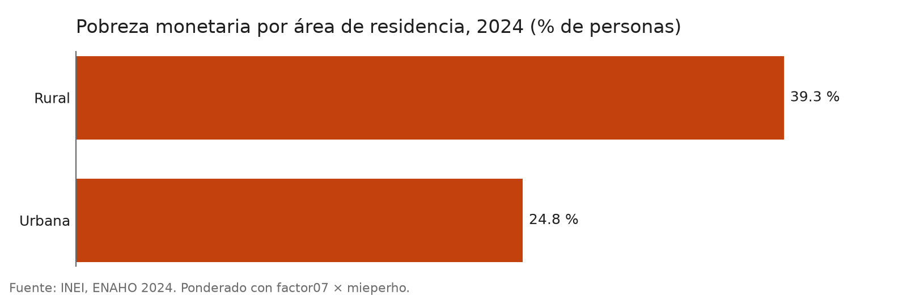
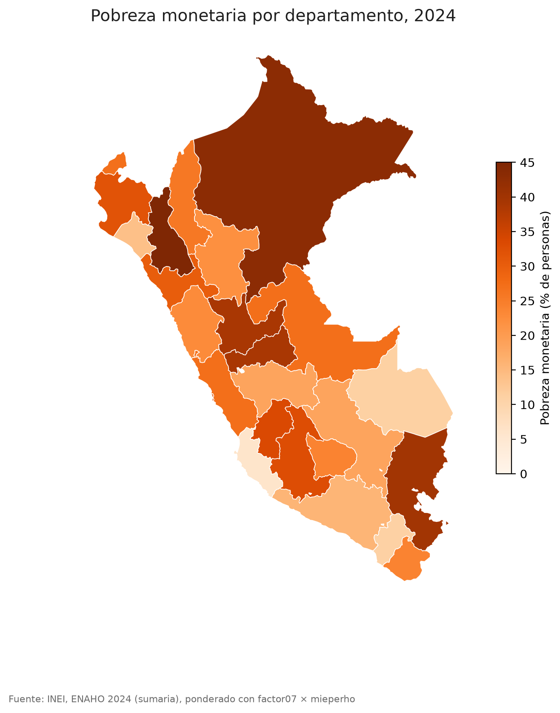

# enaho-skills

Cuatro skills de Claude Code para trabajar la ENAHO del INEI siempre de la misma forma: descargarla,
limpiarla y validarla contra la pobreza oficial, graficarla y mapearla por departamento. La limpieza replica la
pobreza monetaria oficial de 2024: **27.6 %**.

| Pobreza por área | Pobreza por departamento |
|---|---|
|  |  |

Más figuras en [`figuras/`](figuras/): por sexo, grupo de edad y departamento.

| Skill | Entra | Sale |
|---|---|---|
| [`descargando-enaho`](.claude/skills/descargando-enaho/SKILL.md) | El año, de 2015 a 2024 | `datos/<código>-Modulo34.zip`, `datos/<código>-Modulo02.zip`, `datos/peru_departamental_simple.geojson` |
| [`limpiando-enaho`](.claude/skills/limpiando-enaho/SKILL.md) | Los zip de los módulos 34 y 02 | `salidas/personas_<año>.parquet`, `salidas/hogares_<año>.parquet`, [`salidas/validacion.txt`](salidas/validacion.txt) |
| [`graficando-enaho`](.claude/skills/graficando-enaho/SKILL.md) | La base limpia y un corte: área, sexo, edad, dominio o departamento | `figuras/*.png` |
| [`mapeando-enaho`](.claude/skills/mapeando-enaho/SKILL.md) | La base limpia y el GeoJSON | `mapas/pobreza_departamento.png` y `.csv` |

Las skills se encadenan: si falta la base limpia, graficar y mapear llaman primero a `limpiando-enaho`, y si
faltan los zip, esta llama a `descargando-enaho`. Un solo pedido («haz un mapa de la pobreza») puede activar las
tres.

## Instalar

```bash
git clone <este repositorio> && cd enaho-skills
uv sync
```

Requiere [uv](https://docs.astral.sh/uv/) y Claude Code. Las skills están en `.claude/skills/` y se cargan solas al
abrir Claude Code en esta carpeta (compruébelo con `/skills`).

## Bajar los datos

Con Claude Code: «descarga la ENAHO 2024», o a mano:

```bash
uv run .claude/skills/descargando-enaho/scripts/descargar.py --anio 2024
```

Si el portal del INEI falla, bájelos en el navegador y póngalos en `datos/`:

- Módulo 34, sumaria: https://proyectos.inei.gob.pe/iinei/srienaho/descarga/STATA/966-Modulo34.zip
- Módulo 02, miembros: https://proyectos.inei.gob.pe/iinei/srienaho/descarga/STATA/966-Modulo02.zip
- Departamentos: https://raw.githubusercontent.com/d2cml-ai/Data-Science-Python/main/sessions/06-geoespacial/lab/Data/peru_departamental_simple.geojson

`datos/` está en `.gitignore`: los microdatos no se suben.

## Correr todo

```bash
uv run .claude/skills/limpiando-enaho/scripts/limpiar.py --anio 2024
uv run .claude/skills/graficando-enaho/scripts/graficar.py --por area
uv run .claude/skills/graficando-enaho/scripts/graficar.py --por sexo
uv run .claude/skills/graficando-enaho/scripts/graficar.py --por edad
uv run .claude/skills/graficando-enaho/scripts/graficar.py --por departamento
uv run .claude/skills/mapeando-enaho/scripts/mapear.py
```

O, dentro de Claude Code, en lenguaje natural o llamando a la skill con `/`:

```text
¿Cuál fue la pobreza en Cusco en 2024?
Grafica la pobreza urbana y rural
Haz un mapa de la pobreza por departamento
/descargando-enaho 2023
/limpiando-enaho 2023
/graficando-enaho sexo extrema
```

### Otros años

`descargando-enaho` conoce los códigos del INEI de 2015 a 2024, verificados con el nombre de la sumaria dentro de
cada zip. `limpiando-enaho` valida cada año contra su pobreza oficial. 2023, por ejemplo, da 29.05 % (INEI:
29.0 %) con 110,792 residentes habituales. Las comprobaciones de hogares, residentes, pobreza extrema y los 25
departamentos del mapa solo están cargadas para 2024.

## Validación

`salidas/validacion.txt` confirma que la base replica las cifras oficiales del INEI para 2024:

| Cifra | Oficial | Esta base |
|---|---|---|
| Pobreza monetaria | 27.6 % | 27.58 % (sumaria, `factor07 × mieperho`) · 27.53 % (personas, `facpob07`) |
| Pobreza extrema | 5.5 % | 5.50 % |
| Hogares | 33,691 | 33,691 |
| Residentes habituales | 108,664 | 108,664 |
| Urbana / rural | 24.8 % / 39.3 % | 24.8 % / 39.3 % |
| Cajamarca / Cusco / Ica | 45.0 % / 18.5 % / 6.0 % | 45.0 % / 18.5 % / 6.0 % |
| Los 25 departamentos | [referencia de la sesión 16](https://github.com/d2cml-ai/Data-Science-Python/blob/main/sessions/16-skills-enaho/referencias/pobreza_departamento_2024.csv) | 25 de 25 iguales a un decimal; `mapear.py` lo comprueba |

### Una decisión de método

Las cifras por área y departamento se calculan sobre la sumaria ponderada con `factor07 × mieperho`, que es el
método oficial del INEI y reproduce exactamente sus cifras publicadas. Con la base de personas y `facpob07` los
departamentos difieren hasta 0.5 puntos (Huánuco 39.5 en vez de 39.0, Ica 5.9 en vez de 6.0). Sexo y edad solo
existen por persona, así que esos cortes usan `facpob07`. Por eso `limpiando-enaho` guarda dos bases.

## Evaluación

Los tres pedidos de prueba, con y sin skills, se anotan en [evaluacion.md](evaluacion.md).

## Estructura

```text
.claude/skills/
  descargando-enaho/  SKILL.md, scripts/descargar.py
  limpiando-enaho/    SKILL.md, reference.md, scripts/limpiar.py
  graficando-enaho/   SKILL.md, scripts/graficar.py
  mapeando-enaho/     SKILL.md, scripts/mapear.py
salidas/validacion.txt
figuras/  mapas/
evaluacion.md  README.md  pyproject.toml
```

Basado en la [sesión 16](https://github.com/d2cml-ai/Data-Science-Python/tree/main/sessions/16-skills-enaho) del curso
Data Science con Python de d2cml.
